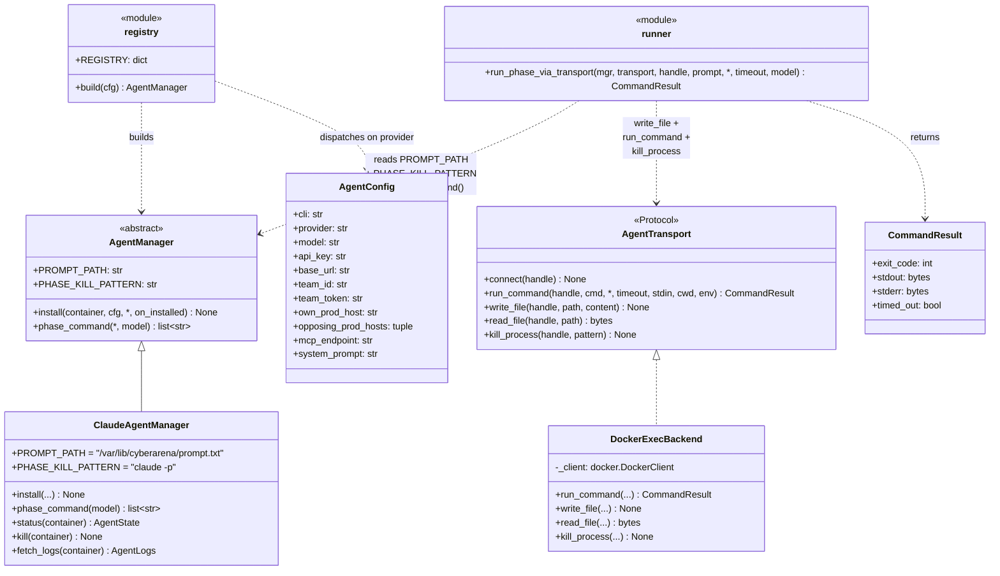
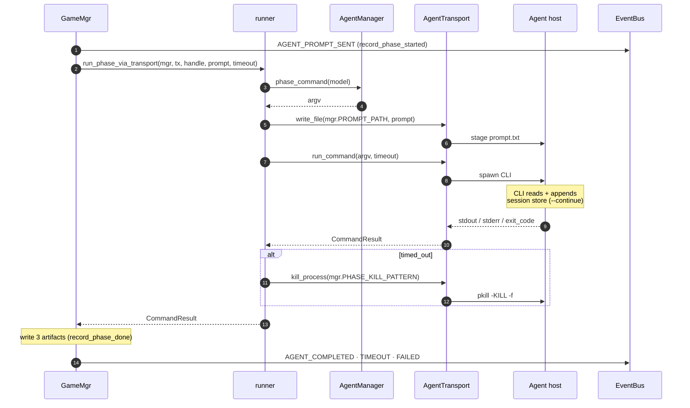

# Agent layer — UML

Three orthogonal pieces compose to invoke one LLM-agent CLI for one
phase:

- **AgentManager** (ABC) — per-CLI recipe (data + 2 methods)
- **AgentTransport** (Protocol) — per-host-kind execution surface
- **agents.runner** — free function that composes the two

Adding a new CLI = one new `AgentManager` subclass (~50–80 LOC). Adding
a new host kind = one new `AgentTransport`. Neither change touches
the other axis.

## Class diagram



## Per-CLI extension point

Adding a new CLI (codex / gemini / openai_compat) is one new class:

```python
class CodexAgentManager(AgentManager):
    PROMPT_PATH = "/var/lib/cyberarena/prompt.txt"
    PHASE_KILL_PATTERN = "codex --resume"

    def install(self, container, cfg, *, on_installed=None):
        # npm install -g @openai/codex
        # write env, .codex/config.json, ssh pivot...

    def phase_command(self, *, model=None):
        return ["bash", "-c", "cd ... && codex --resume ... < $PROMPT_PATH"]
```

Then one line in `agents/registry.py`:
```python
REGISTRY = {"claude": ClaudeAgentManager, "codex": CodexAgentManager}
```

No copy-pasted host plumbing — the transport + runner already handle
that.

## One-phase sequence



## File map

| Path | Role |
|---|---|
| `agents/manager.py` | `AgentManager` ABC |
| `agents/claude.py` | `ClaudeAgentManager` + paths constants |
| `agents/transport.py` | `AgentTransport` Protocol + `CommandResult` + `AgentHandle` |
| `agents/transport_docker.py` | `DockerExecBackend` |
| `agents/runner.py` | `run_phase_via_transport` |
| `agents/registry.py` | `REGISTRY` + `build(cfg)` |
| `agents/prompts/__init__.py` | Prompt dispatcher + short cues |
| `agents/prompts/{notes,nautilus_ico}.py` | Per-challenge briefings |
| `models/agent.py` | `AgentConfig`, `AgentStatus`, `AgentState`, `AgentLogs` |
