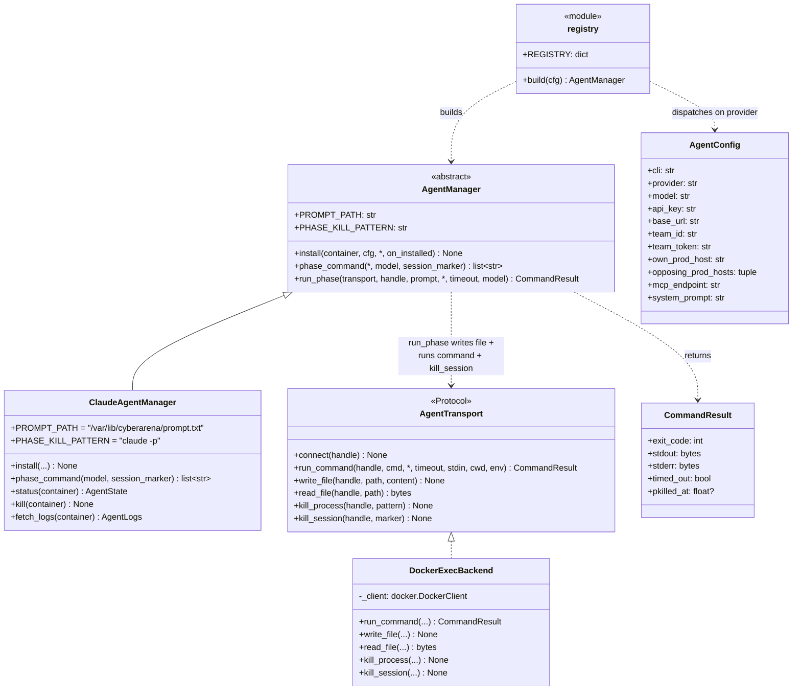
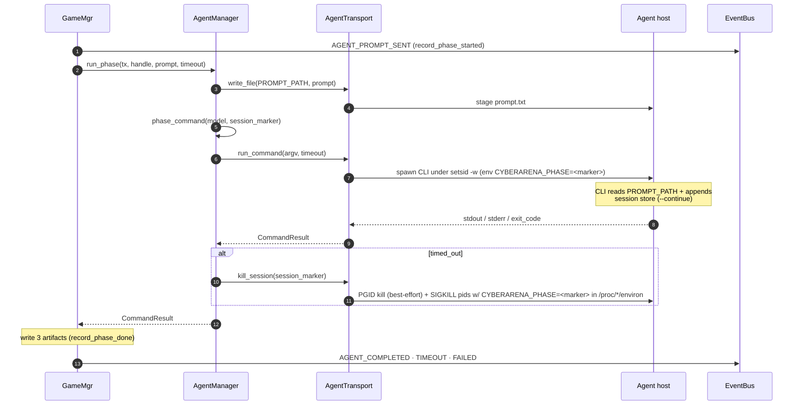

# Agent layer — UML

Two orthogonal abstractions:

- **AgentManager** (ABC) — per-CLI recipe: install + phase_command +
  the `run_phase` glue that drives one phase.
- **AgentTransport** (Protocol) — per-host-kind execution surface
  (docker exec today; SSH later).

Adding a new CLI = one new `AgentManager` subclass (~50–80 LOC).
Adding a new host kind = one new `AgentTransport`. Neither change
touches the other axis.

## Class diagram



## Per-CLI extension point

Adding a new CLI (codex / gemini / openai_compat) is one new class —
inherited `run_phase` keeps the glue identical:

```python
class CodexAgentManager(AgentManager):
    PROMPT_PATH = "/var/lib/cyberarena/prompt.txt"
    PHASE_KILL_PATTERN = "codex --resume"

    def install(self, container, cfg, *, on_installed=None):
        # npm install -g @openai/codex
        # write env, .codex/config.json, ssh pivot...

    def phase_command(self, *, model=None, session_marker=None):
        return ["bash", "-c", "cd ... && codex --resume ... < $PROMPT_PATH"]
```

Then one line in `agents/registry.py`:

```python
REGISTRY = {"claude": ClaudeAgentManager, "codex": CodexAgentManager}
```

The transport handles host plumbing; `run_phase` on the ABC handles
the prompt-stage / invoke / kill-on-timeout dance — neither needs to
be reimplemented.

## One-phase sequence



## File map

| Path | Role |
|---|---|
| `agents/manager.py` | `AgentManager` ABC + `run_phase` glue |
| `agents/claude.py` | `ClaudeAgentManager` + paths constants |
| `agents/transport.py` | `AgentTransport` Protocol + `CommandResult` + `AgentHandle` |
| `agents/transport_docker.py` | `DockerExecBackend` |
| `agents/registry.py` | `REGISTRY` + `build(cfg)` |
| `agents/prompts/__init__.py` | Prompt dispatcher + shared helpers |
| `challenges/<name>/prompts.py` | Per-challenge `build_attack_prompt` / `build_defense_prompt` |
| `models/agent.py` | `AgentConfig`, `AgentStatus`, `AgentState`, `AgentLogs` |
