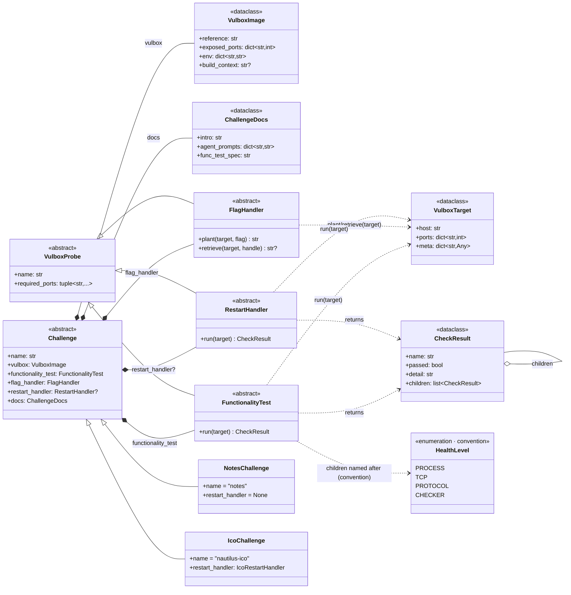
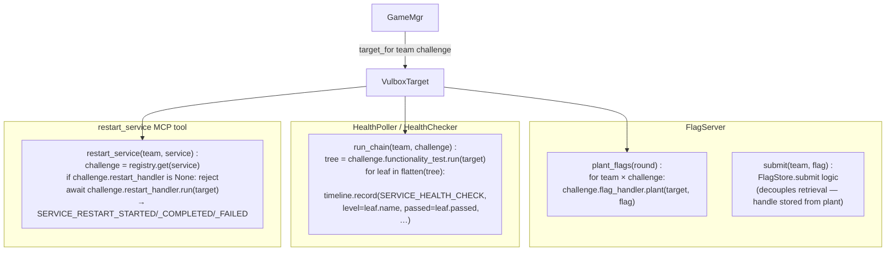

# Challenge layer — UML

Pluggable per-challenge model. Each challenge lives in one directory
under [`challenges/<name>/`](../../challenges) and exposes a `Challenge`
subclass composed of five things:

```
challenge = (vulbox, functionality_test, flag_handler,
             restart_handler?, docs)
```

The orchestrator pulls the components off the `Challenge` instance and
drives each independently — no per-mechanism dispatch lives in the
framework. Two challenges in tree today: built-in `notes` (attack-only)
and DEFCON `nautilus-ico` (full attack + defense workflow).

> **Migration status**: the v2 abstract interface (`Challenge` ABC +
> probes) is defined in [`challenges/interface/`](../../challenges/interface/);
> see [docs/challenge_interface_v2_plan.md](../challenge_interface_v2_plan.md)
> for the staged plan to retire the v1 `ChallengeSource` / `ChallengeSpec`
> / `FlagMechanism` layer it replaces. The diagrams below describe the
> target design.

## Class diagram (target)



## How the facilities use it



Three properties of this shape worth calling out:

1. **No mechanism enum at the framework level.** v1's `FlagMechanism`
   (SERVICE_PROTOCOL / FILE_AT_PATH / …) is retired — `FlagHandler.plant`
   is opaque to the framework. Each challenge decides how the flag
   enters the vulbox (PUT over the service's own protocol, docker exec
   write to a file path, an env var the image reads at start, anything).
2. **`HealthLevel` is convention, not contract.** When the challenge's
   `FunctionalityTest.run()` returns a `CheckResult` tree with children
   named PROCESS / TCP / PROTOCOL / CHECKER, the orchestrator emits one
   `SERVICE_HEALTH_CHECK` event per leaf and the panel renders the
   familiar chip strip. A challenge with a different shape (one leaf,
   nested groups, …) is free to do that; framework code never branches
   on the names.
3. **`restart_handler` is optional.** Challenges with no defense
   workflow leave it `None`. The orchestrator's defense-kickoff
   dispatch + the `restart_service` MCP tool both filter on this and
   skip cleanly.

## Per-challenge directory layout

```
challenges/
  interface/                       # the abstract ABCs (no deps)
    challenge.py                   # Challenge, VulboxImage, ChallengeDocs
    probe.py                       # VulboxProbe, FunctionalityTest,
                                   # FlagHandler, RestartHandler,
                                   # VulboxTarget, CheckResult, HealthLevel
    __init__.py
    ORIGINAL_DESIGN.md             # historical: the 4-component
                                   # original (no RestartHandler yet)

  notes/                           # game-simple notes (attack-only)
    __init__.py                    # exports NotesChallenge()
    challenge.py                   # NotesChallenge(Challenge)
    functionality_test.py          # port-connect + LIST/COUNT
    flag_handler.py                # protocol-level PUT/GET
    prompts.py                     # attack prompt (no defense)

  nautilus_ico/                    # DEFCON ico (full workflow)
    __init__.py
    challenge.py                   # IcoChallenge(Challenge)
    functionality_test.py          # 4-level chain via docker exec
    flag_handler.py                # FILE_AT_PATH via docker exec /flag
    restart_handler.py             # docker exec /arena/restart.sh
    prompts.py                     # attack + defense prompts
    spec.toml                      # vendor pin + image tag

  registry.py                      # name → Challenge instance lookup
```

## VulboxTarget — the only thing that flows at runtime

`GameMgr.target_for(team_id, challenge)` constructs a `VulboxTarget`
per call:

```python
VulboxTarget(
    host = team.prod,                                # docker container name
    ports = dict(challenge.vulbox.exposed_ports),    # named-port map
    meta = {
        "team_id": team_id,
        "container_id": …,
        "exec_in_container": <callable>,             # docker exec helper
    },
)
```

Handlers that need to docker-exec inside the vulbox pull the callable
out of `target.meta["exec_in_container"]` — that's the documented
convention for the bridge between the framework-agnostic abstract
interface and the docker-exec world the orchestrator currently lives
in. Future transports (k8s, real SSH) swap what's in `meta`; handler
code is untouched.

## Adding a new challenge

```
challenges/<new_chal>/
  __init__.py
  challenge.py            # NewChallenge(Challenge)
  functionality_test.py
  flag_handler.py
  restart_handler.py      # only if defense-capable
  prompts.py
```

Plus one line in `challenges/registry.py` registering the instance.
Zero touches to [gamemgr/](../../gamemgr/), [flag/](../../flag/),
[health/](../../health/), or [agents/prompts/__init__.py](../../agents/prompts/__init__.py).

## File map

| Path | Role |
|---|---|
| [`challenges/interface/challenge.py`](../../challenges/interface/challenge.py) | `Challenge` ABC + `VulboxImage` + `ChallengeDocs` |
| [`challenges/interface/probe.py`](../../challenges/interface/probe.py) | `VulboxProbe`, `FunctionalityTest`, `FlagHandler`, `RestartHandler`, `VulboxTarget`, `CheckResult`, `HealthLevel` |
| [`challenges/interface/ORIGINAL_DESIGN.md`](../../challenges/interface/ORIGINAL_DESIGN.md) | snapshot of the four-component original (pre-`RestartHandler`) — historical reference |
| `challenges/<name>/challenge.py` | concrete `Challenge` subclass — composition root |
| `challenges/<name>/functionality_test.py` | `FunctionalityTest` implementation |
| `challenges/<name>/flag_handler.py` | `FlagHandler` implementation |
| `challenges/<name>/restart_handler.py` | `RestartHandler` implementation (defense-capable only) |
| `challenges/<name>/prompts.py` | `build_attack_prompt(cfg)` / `build_defense_prompt(cfg, …)` for the challenge |
| `challenges/registry.py` | `name → Challenge` lookup, replaces v1's `ChallengeSource` |
