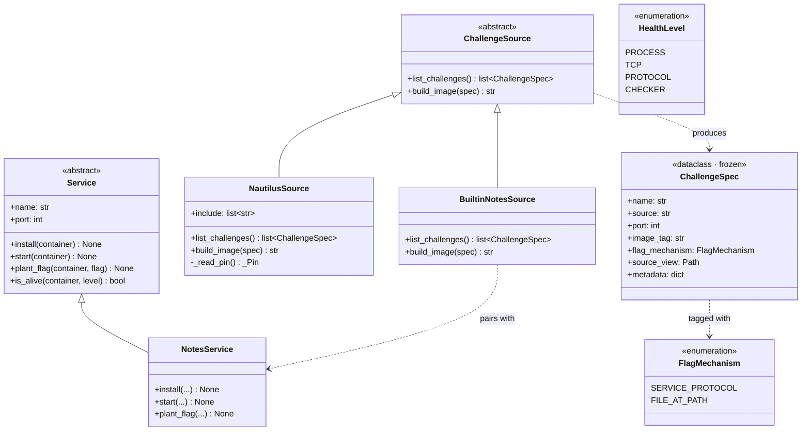
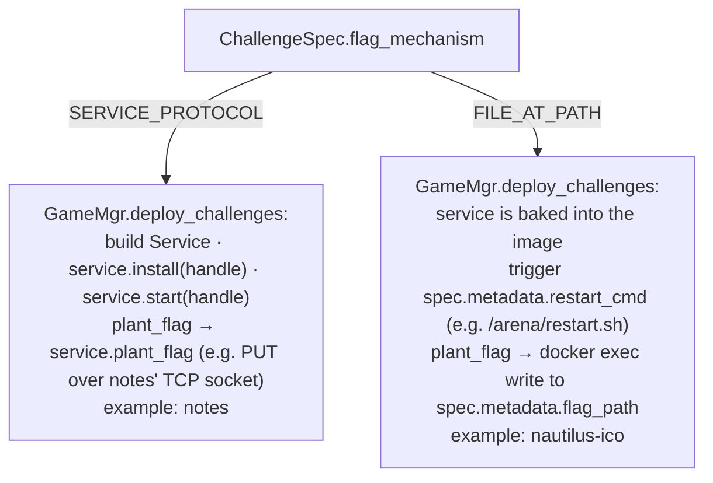
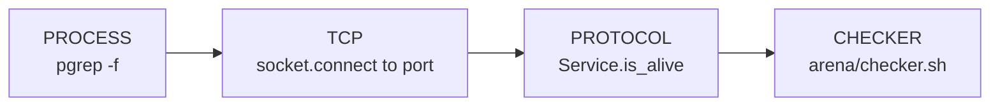
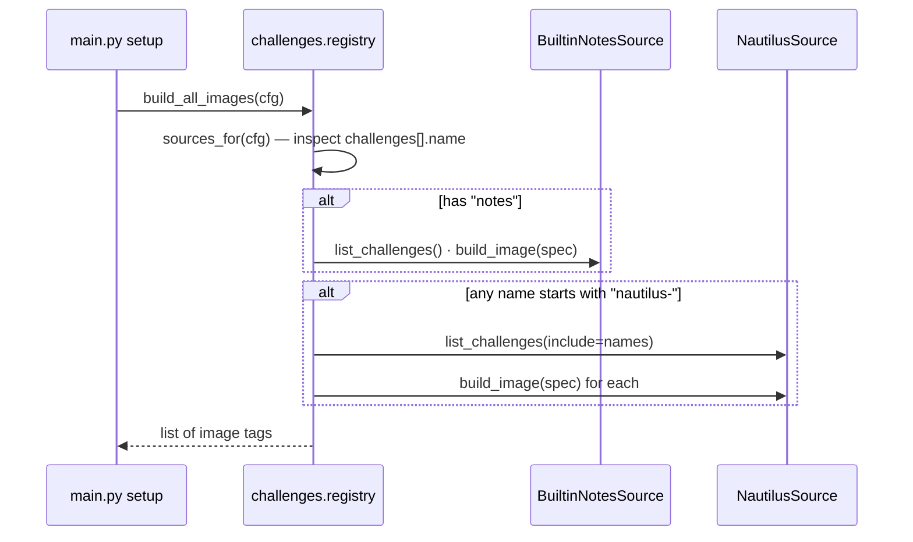

# Challenge layer — UML

Pluggable challenge model: a **ChallengeSource** discovers challenges
(from a built-in module or a vendored upstream repo), produces a
**ChallengeSpec** per challenge, and the spec drives image builds +
flag plant + health checks. Two sources today: built-in `notes` and
upstream `nautilus`.

## Class diagram

## Two flag mechanisms — two deploy paths

`spec.metadata` keys per mechanism:

| Key | When | Used by |
|---|---|---|
| `restart_cmd` | FILE_AT_PATH | `GameMgr.restart_service` — the MCP-triggered rebuild |
| `flag_path` | FILE_AT_PATH | `GameMgr._plant_file_at_path` |
| `health_check.process_pattern` | both | `_emit_health_chain` PROCESS step |
| `health_check.checker_command` | nautilus | `_emit_health_chain` CHECKER step (upstream poller) |
| `upstream_name` | nautilus | image tag computation |

## Health chain — 4 levels of "is the service alive"

Each level is a deeper "are you really alive". Cheap sanity →
expensive gameplay correctness. Hollow patches that break gameplay
get caught at CHECKER even if PROCESS/TCP/PROTOCOL pass.

`_emit_health_chain` fires after every `restart_service` job AND
once at DEFENSE→ATTACK transition (`_on_defense_end_health_check`).
See [game_manager.md](game_manager.md) and the four health levels
discussion in [persistent_memory_agent_plan_v1.md](../persistent_memory_agent_plan_v1.md).

## Registry: how `main.py setup` picks sources

`NautilusSource` only instantiates if at least one challenge name
matches — saves pulling the vendored upstream repo when running a
notes-only game.

## File map

| Path | Role |
|---|---|
| `challenges/source.py` | `ChallengeSpec`, `ChallengeSource` ABC, `FlagMechanism`, `HealthLevel` enums |
| `challenges/notes.py` | `BuiltinNotesSource` + `NotesService` |
| `challenges/nautilus.py` | `NautilusSource` (vendored upstream challenges) |
| `challenges/nautilus/ico/spec.toml` | DEFCON framework spec for ico |
| `challenges/registry.py` | `default_sources` · `sources_for(cfg)` · `build_all_images(cfg)` · `build(type_)` |
| `vendor/nautilus-finals-2025/` | vendored upstream challenge tree (git-ignored) |
