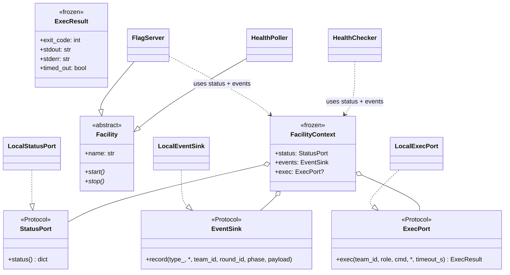
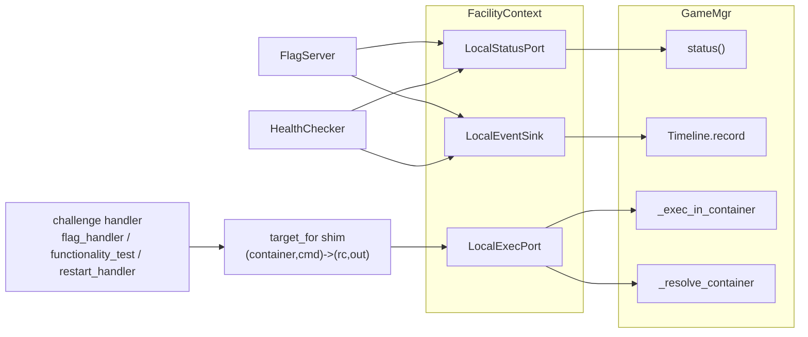
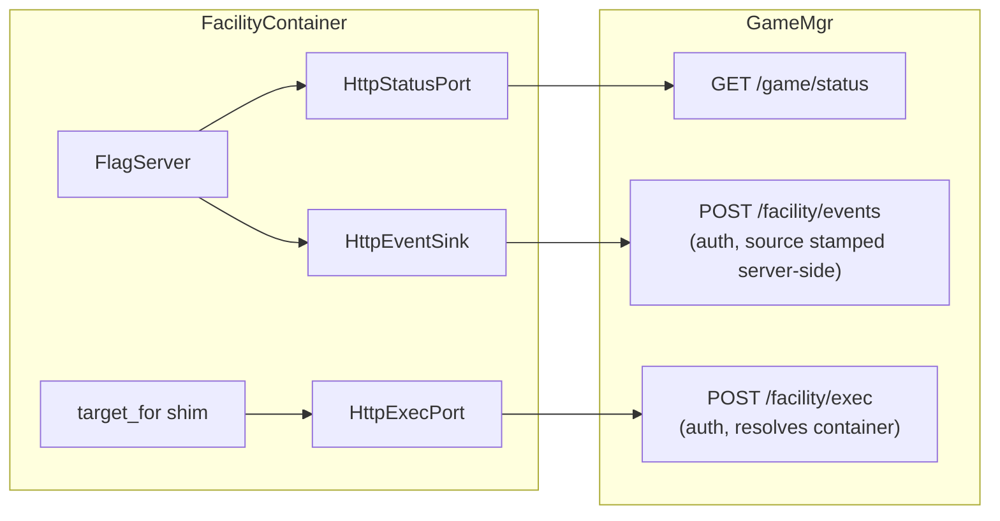

# Facility abstraction — UML

`facility/` defines the boundary between a facility (FlagServer,
HealthPoller, …) and its host (GameMgr): three ports bundled in a
`FacilityContext`, plus a thin `Facility` ABC. Stdlib-only; imports
nothing from `gamemgr` / `flag` / `health`, so the boundary stays
acyclic. Design rationale + the deferred Phase 2/3 lives in
[../facility_abstraction_plan_v1.md](../facility_abstraction_plan_v1.md).

## Class diagram

`exec` is consumed by the *target builder* (`GameMgr.target_for`), not by
FlagServer/HealthChecker directly — they reach exec through the
`VulboxTarget.meta["exec_in_container"]` callable the builder installs.

## In-process wiring (today)

`LocalExecPort` resolves `(team_id, role)` → container host-side, then runs
the blocking docker exec on a daemon thread with a `join(timeout_s)` deadline
so a hung exec can't wedge the round loop.

## Future: containerized (Phase 2/3, not built)

Same facility code, different adapters — the boundary is unchanged:

## What it does NOT do

- **Not a daemon framework.** `Facility.start/stop` default to no-ops;
  facilities are still driven by GameMgr phase callbacks (`rotate`,
  `on_attack_enter`), not a self-owned loop.
- **Not a new event bus.** `EventSink` is a one-way append mirroring
  `Timeline.record`; nothing subscribes.
- **Does not change challenge code.** The `(container_name, cmd) -> (rc,
  output)` contract in `challenges/interface/probe.py` is untouched; the
  exec transport swap happens behind the `target_for` shim.

## File map

| Path | Role |
|---|---|
| `facility/ports.py` | `StatusPort` / `EventSink` / `ExecPort` + `ExecResult` |
| `facility/base.py` | `Facility` ABC + `FacilityContext` |
| `facility/adapters_local.py` | `Local*` in-process adapters |
| `facility/__init__.py` | re-exports |
