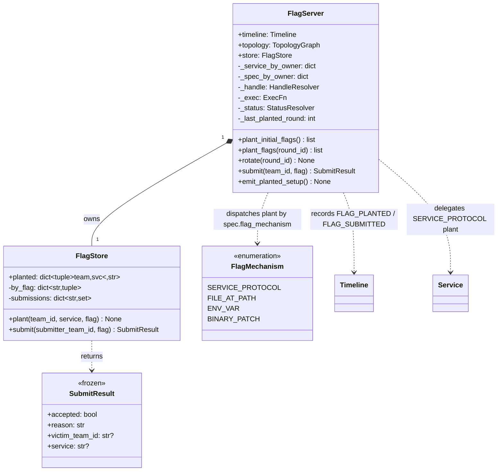
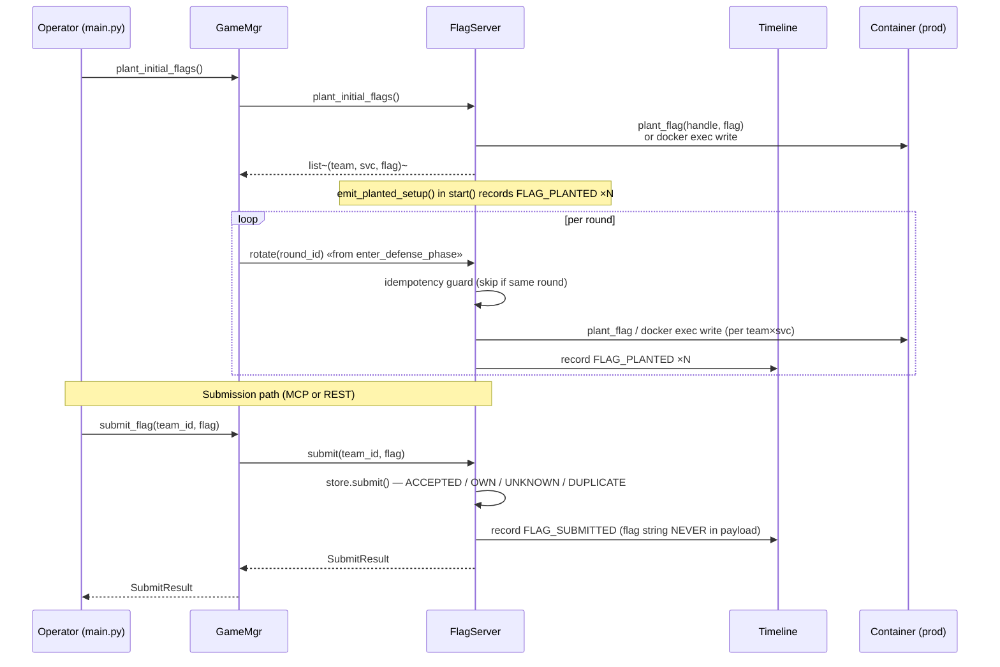

# Flag facility — UML

`flag/` is an independent package consumed by `GameMgr`. Two classes:

- **`FlagStore`** — pure in-memory state. Owns the
  ACCEPTED/UNKNOWN/OWN/DUPLICATE decision logic. Re-planting a flag
  drops the old one from the inverted index (so it submits as UNKNOWN
  after rotation). No I/O, no timeline, no docker.
- **`FlagServer`** — orchestration over the store. Plants flags into
  challenge containers (SERVICE_PROTOCOL via the adapter's
  `plant_flag(handle, flag)`, FILE_AT_PATH via `docker exec` write),
  runs per-round rotation, verifies submissions, and records
  `FLAG_PLANTED` / `FLAG_SUBMITTED` on the Timeline.

GameMgr keeps the public surface (`plant_initial_flags`, `plant_flags`,
`submit_flag`, `flags`) and delegates every call to FlagServer.
Pluggable per `Service` ABC + `FlagMechanism` — no demo-service
specifics are hardcoded into the facility.

## Class diagram

## Plant dispatch

`plant_flags(round_id)` walks two mutable dicts that GameMgr.deploy_challenges
populates and FlagServer holds by reference:

| Path | Trigger | Mechanism |
|---|---|---|
| `_service_by_owner[(team, svc)] → Service` | spec.flag_mechanism = `SERVICE_PROTOCOL` | `service.plant_flag(handle, flag)` — adapter owns wire protocol (e.g. notes does a PUT) |
| `_spec_by_owner[(team, svc)] → ChallengeSpec` | spec.flag_mechanism = `FILE_AT_PATH` | `docker exec <prod> sh -c 'printf %s <flag> > <flag_path> && chmod 644 <flag_path>'` |

Both paths update `store.plant(team, svc, flag)` so submissions resolve
correctly afterwards. `ENV_VAR` and `BINARY_PATCH` mechanisms are
defined in `FlagMechanism` but not yet dispatched here — adding them
is one switch arm.

## Rotation lifecycle

## What it does NOT do

- **Not a subscriber.** GameMgr drives rotation and submit calls
  directly; FlagServer doesn't listen to PHASE_CHANGE or anything else.
- **Doesn't own the kickoff handler set or `_defense_pending`** —
  those are defense-phase orchestration state on GameMgr.
- **Doesn't manage challenge deployment** — that's still
  `GameMgr.deploy_challenges()`; FlagServer just plants into already-
  deployed services.
- **Doesn't leak flag strings.** The flag never appears in
  `FLAG_PLANTED` or `FLAG_SUBMITTED` payloads — those go to the public
  panel + on-disk JSONL.

## File map

| Path | Role |
|---|---|
| `flag/__init__.py` | re-exports `FlagServer`, `FlagStore`, `SubmitResult`, `new_flag` |
| `flag/store.py` | `FlagStore` + `SubmitResult` + `new_flag` (state + decision logic) |
| `flag/server.py` | `FlagServer` (plant/rotate/submit + timeline records) |
