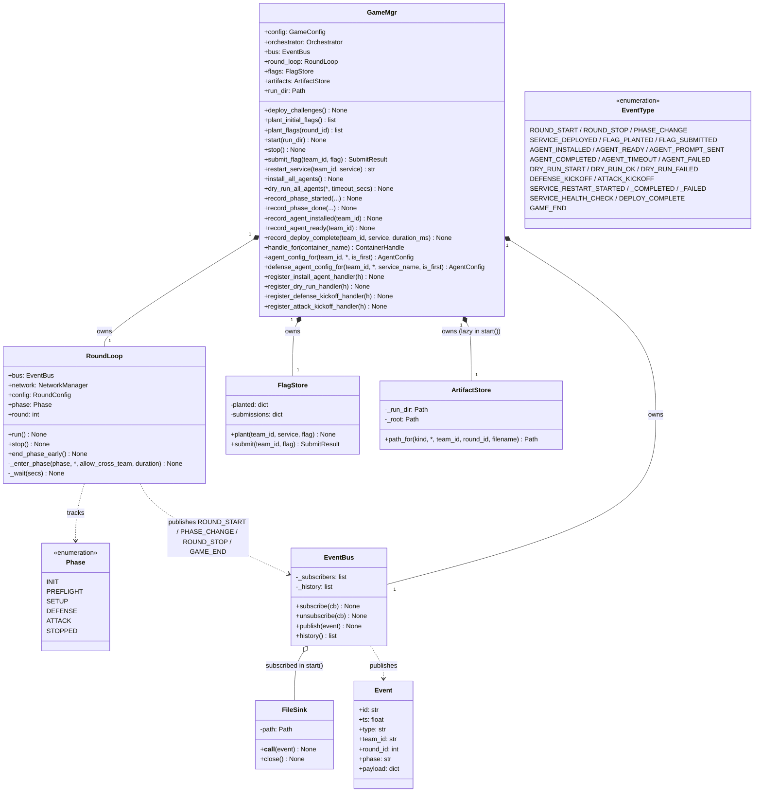
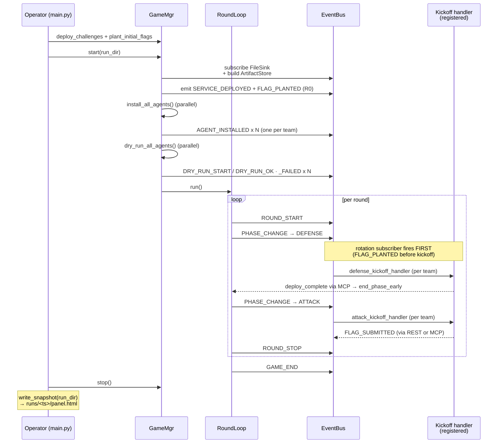

# GameMgr layer — UML

`GameMgr` is the domain controller. It owns the event bus, the round
loop, the flag store, the artifact store, and the per-team agent
handlers. Everything that's "the game" (vs. "the CLI" or "the host")
lives here.

## Class diagram

## Phase state machine

## Event bus subscribers (in subscription order)

`bus.publish` awaits subscribers sequentially. Order matters — a
slow subscriber blocks the rest until it returns.

| # | Subscriber | Fires on | Job |
|---|---|---|---|
| 1 | `_on_persist_service_logs` | `ROUND_STOP` | `docker logs <team{N}_prod>` → `runs/<ts>/artifacts/<team>/round-N/docker.log` |
| 2 | `_on_defense_end_health_check` | `PHASE_CHANGE` → ATTACK | run 4-level health chain per team |
| 3 | `_on_rotation_event` | `PHASE_CHANGE` → DEFENSE | `plant_flags(round_id)` + emit FLAG_PLANTED — MUST be before kickoff |
| 4 | `_on_defense_kickoff` | `PHASE_CHANGE` → DEFENSE | emit DEFENSE_KICKOFF + await asyncio.gather of defense handlers |
| 5 | `_on_attack_kickoff` | `PHASE_CHANGE` → ATTACK | emit ATTACK_KICKOFF + await asyncio.gather of attack handlers |
| 6 | `_on_deploy_complete` | `DEPLOY_COMPLETE` | drain `_defense_pending`; signal RoundLoop early-end |
| + | `FileSink` | every event | append one JSON line to `events.jsonl` (subscribed in `start()`) |

## Game lifecycle sequence

## File map

| Path | Role |
|---|---|
| `gamemgr/game_mgr.py` | `GameMgr` (the class) |
| `gamemgr/round.py` | `RoundLoop` + `Phase` enum |
| `gamemgr/events.py` | `EventBus` + `EventType` + `Event` + `FileSink` |
| `gamemgr/flag.py` | `FlagStore` + `new_flag` + `SubmitResult` |
| `gamemgr/artifacts.py` | `ArtifactStore` + `ArtifactKind` |
| `gamemgr/config.py` | `GameConfig` + `ChallengeConfig` + `RoundConfig` + YAML loader |
| `gamemgr/api.py` | FastAPI `build_app(game, shutdown)` |
| `gamemgr/mcp_server.py` | MCP tools (submit_flag, report_ready, restart_service, …) |
| `gamemgr/panel_snapshot.py` | `write_snapshot(run_dir)` |
