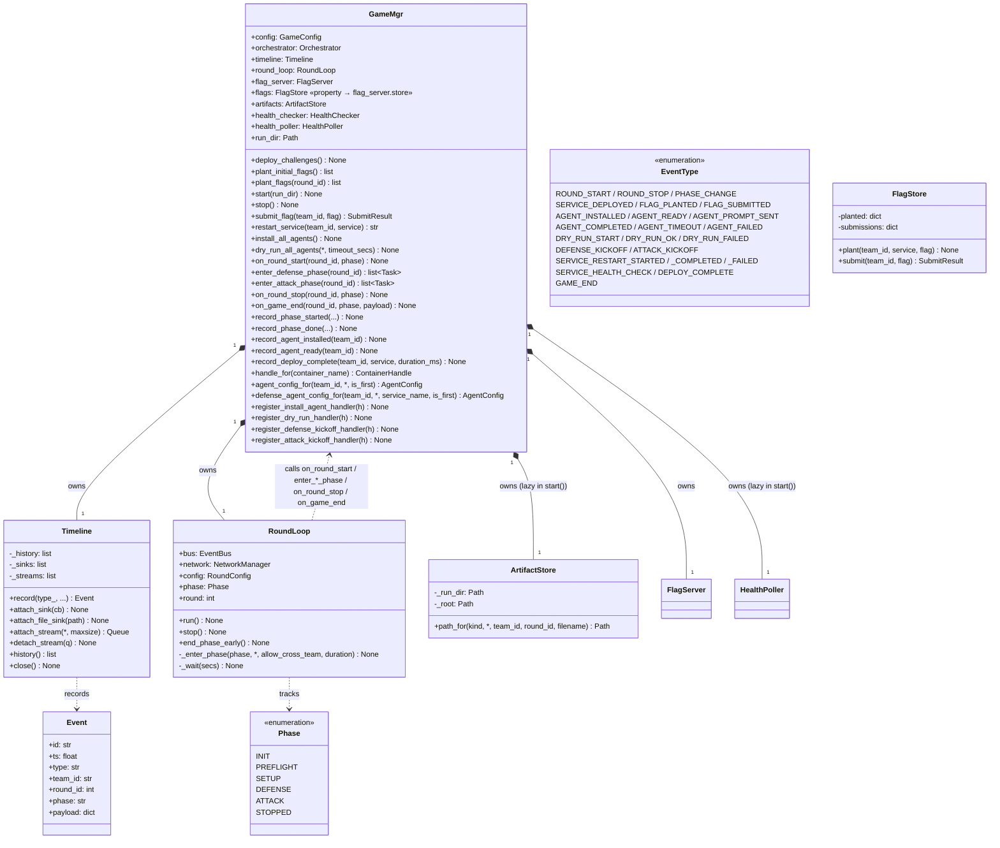
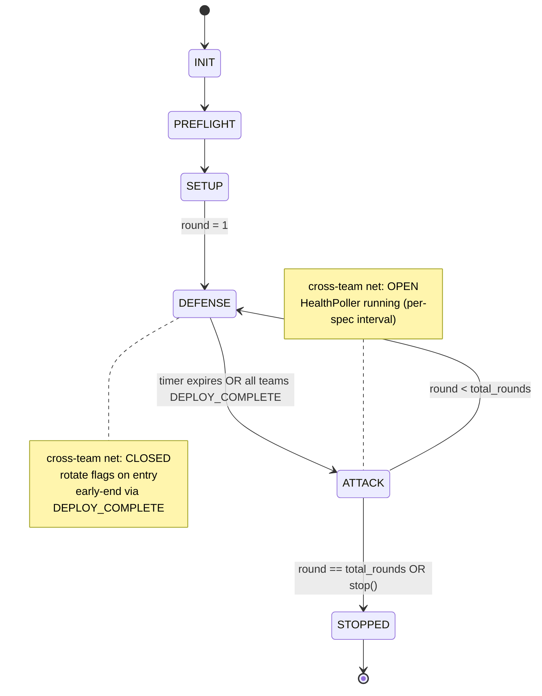
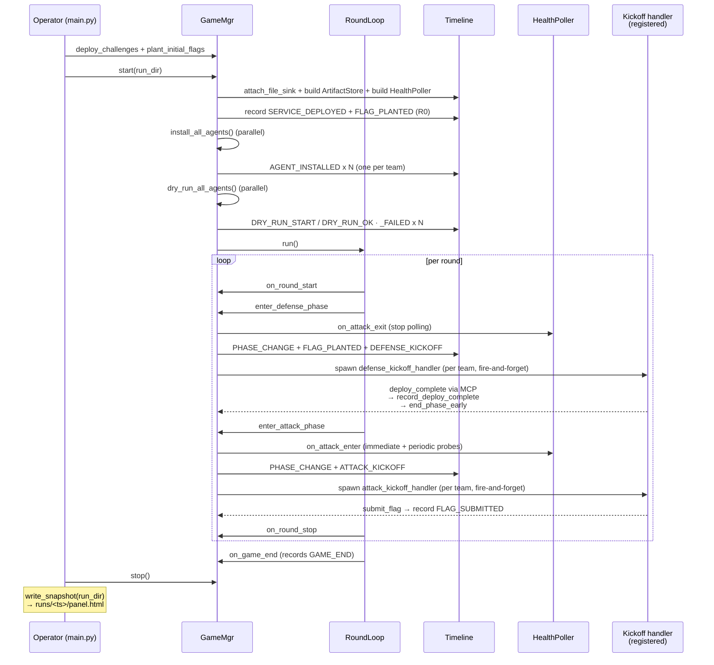

# GameMgr layer — UML

`GameMgr` is the orchestration executor. It owns the timeline, the
round loop, the artifact store, and the per-team agent handlers, and
holds references to two independent facilities: the FlagServer and the
HealthPoller. Game state and per-flag/per-probe mechanics live in those
facilities; GameMgr keeps only the public method shapes
(`plant_initial_flags`, `submit_flag`, `restart_service`, `flags`)
that callers expect, and delegates the work.

**Post-bus refactor (2026-06).** GameMgr no longer subscribes to
events. Internal control flow is driven by direct method calls
(`enter_defense_phase`, `enter_attack_phase`, `record_deploy_complete`,
…). `Timeline` is observation-only — used by FileSink + WebSocket panel
consumers. See [timeline.md](timeline.md), [flag.md](flag.md), and
[health.md](health.md).

## Class diagram

## Phase state machine

## RoundLoop ↔ GameMgr dispatch

Direct method calls — no pub-sub. Order is encoded in each method
body (e.g. `enter_defense_phase` rotates flags BEFORE spawning kickoff
tasks). Long-running work is fire-and-forget via `asyncio.create_task`
so phase transitions never block.

| Callback | Fires on | Job |
|---|---|---|
| `on_round_start(round_id, phase)` | top of each round | record ROUND_START |
| `enter_defense_phase(round_id)` | round-loop enters DEFENSE | record PHASE_CHANGE → stop HealthPoller → `_rotate_flags` (FLAG_PLANTED records) → `_spawn_defense_kickoff` (DEFENSE_KICKOFF records + per-team handler tasks) |
| `enter_attack_phase(round_id)` | round-loop enters ATTACK | record PHASE_CHANGE → `HealthPoller.on_attack_enter` (immediate probe + periodic loop per target) → `_spawn_attack_kickoff` |
| `on_round_stop(round_id, phase)` | bottom of each round | record ROUND_STOP → `_persist_service_logs` (docker logs → service-logs/) |
| `on_game_end(round_id, phase, payload)` | round-loop finally | record GAME_END |
| `record_deploy_complete(...)` | MCP `report_deploy_complete` | record DEPLOY_COMPLETE always; drain `_defense_pending` + `end_phase_early` only when current phase is DEFENSE (late reports from claude that flushed past the phase boundary record on the timeline but must not cut ATTACK short) |
| `record_agent_ready(team_id)` | MCP `report_ready` | record AGENT_READY + set `_ready_events[team_id]` |

## Game lifecycle sequence

## File map

| Path | Role |
|---|---|
| `gamemgr/game_mgr.py` | `GameMgr` (the class) |
| `gamemgr/round.py` | `RoundLoop` + `Phase` enum (calls back into GameMgr) |
| `gamemgr/timeline.py` | `Timeline` (append-only telemetry; replaces EventBus) |
| `gamemgr/events.py` | `EventType` + `Event` + `new_event` (data shapes only) |
| `flag/store.py` | `FlagStore` + `new_flag` + `SubmitResult` (in-memory state) |
| `flag/server.py` | `FlagServer` (planting + rotation + submit + timeline records) |
| `gamemgr/artifacts.py` | `ArtifactStore` + `ArtifactKind` |
| `gamemgr/config.py` | `GameConfig` + `ChallengeConfig` + `RoundConfig` + YAML loader |
| `gamemgr/api.py` | FastAPI `build_app(game, shutdown)` |
| `gamemgr/mcp_server.py` | MCP tools (submit_flag, report_ready, restart_service, …) |
| `gamemgr/panel_snapshot.py` | `write_snapshot(run_dir)` |
| `health/checker.py` | `HealthChecker` — runs the challenge's `FunctionalityTest`, emits one event per `CheckResult` leaf |
| `health/poller.py` | `HealthPoller` (ATTACK-only periodic + trigger_now) |
