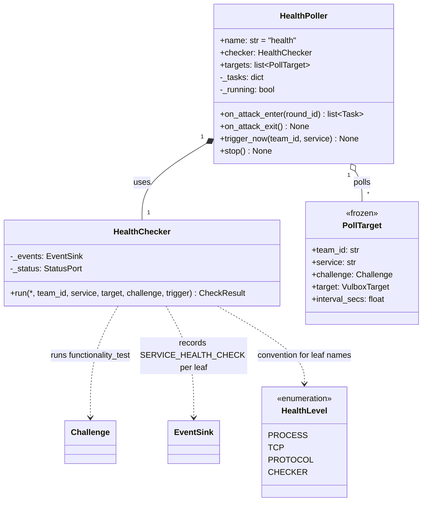
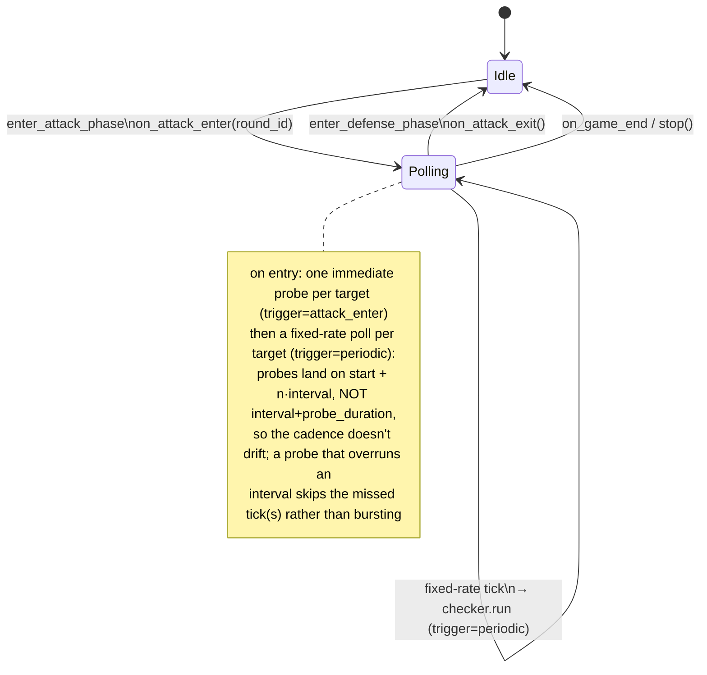

# Health facility — UML

`health/` is an independent package consumed by `GameMgr`. Two classes:

- **`HealthChecker`** — thin wrapper that runs
  `challenge.functionality_test.run(target)` in a thread executor,
  walks the returned `CheckResult` tree, and emits one
  `SERVICE_HEALTH_CHECK` per leaf. Stateless; takes a `FacilityContext`
  and uses `ctx.events` (records) + `ctx.status` (round/phase stamping).
  Each event carries a `trigger` (`periodic` / `attack_enter` /
  `restart`) so off-cadence one-shots are distinguishable from periodic
  ticks.

- **`HealthPoller`** — periodic scheduler and the health `Facility`
  (`name="health"`, overrides `stop()`). Driven by GameMgr at phase
  boundaries; does not subscribe to anything. Owns per-target periodic
  tasks (one per (team, defense-capable service)). Also exposes
  `trigger_now(team, service)` for the restart-post one-shot probe.

The package is pluggable per the v2 `Challenge` ABC: each PollTarget
holds a concrete `Challenge` + a pre-built `VulboxTarget`, and the
checker only knows to call `challenge.functionality_test.run(target)`.

## Class diagram

## State machine — when the poller is running

`trigger_now` is allowed in **either** state — used by `_run_restart_job`
in `GameMgr` to surface a fresh check right after a successful restart,
even during DEFENSE. That probe is tagged `trigger="restart"`.

### Trigger tagging

Every `SERVICE_HEALTH_CHECK` carries a `trigger` in its payload:

| trigger | source | on the poll grid? |
|---|---|---|
| `periodic` | the fixed-rate poll loop | yes |
| `attack_enter` | the one immediate probe at ATTACK entry | no (t≈0 of ATTACK) |
| `restart` | `trigger_now`, post-`restart_service` | no (whenever the restart finished) |

The two one-shots land off the periodic grid **by design** (a probe is
wanted at attack entry and right after a restart). The tag is how a
reader — and the panel, which draws off-cadence probes as a diamond
(periodic ticks are circles) — tells an intentional one-shot from a
drifting periodic tick.

## Configuration

- **Which services get polled:** `build_targets` filters on
  `challenge.restart_handler is None`. Attack-only challenges (notes)
  have nothing to defend, so periodic CHECKER probes there would be
  wasted load.
- **Per-challenge poll interval:** lives in
  [`challenges/registry.py::_HEALTH_INTERVAL_SECS`](../../challenges/registry.py).
  `build_targets` reads it via the `interval_lookup` injected callable
  (typically `registry.health_interval_secs`) with `DEFAULT_INTERVAL_SECS`
  (10s) as the fallback.
- **Leaf names:** the `HealthLevel` enum (PROCESS / TCP / PROTOCOL /
  CHECKER) is a convention. The framework emits one event per
  `CheckResult` leaf using `leaf.name` verbatim; both bundled
  challenges use this convention. A challenge whose `FunctionalityTest`
  returns a different tree shape (one leaf, nested groups) is free to;
  no framework code branches on the names.

## What it does NOT do

- **Does not subscribe to anything.** GameMgr drives all entry/exit;
  the checker has no event coupling beyond `ctx.events.record()`.
- **Does not run during DEFENSE.** `on_attack_exit` cancels all tasks
  on every DEFENSE entry; `trigger_now` is the only DEFENSE-time path.
- **Does not deduplicate** a `trigger_now` racing the periodic loop.
  Both records are independent events; the panel reads them as-is.

## File map

| Path | Role |
|---|---|
| `health/__init__.py` | re-exports `HealthChecker`, `HealthPoller`, `PollTarget` |
| `health/checker.py` | `HealthChecker.run` + `leaves(tree)` tree-walker |
| `health/poller.py` | `HealthPoller` + `PollTarget` + `build_targets` + `DEFAULT_INTERVAL_SECS` |
