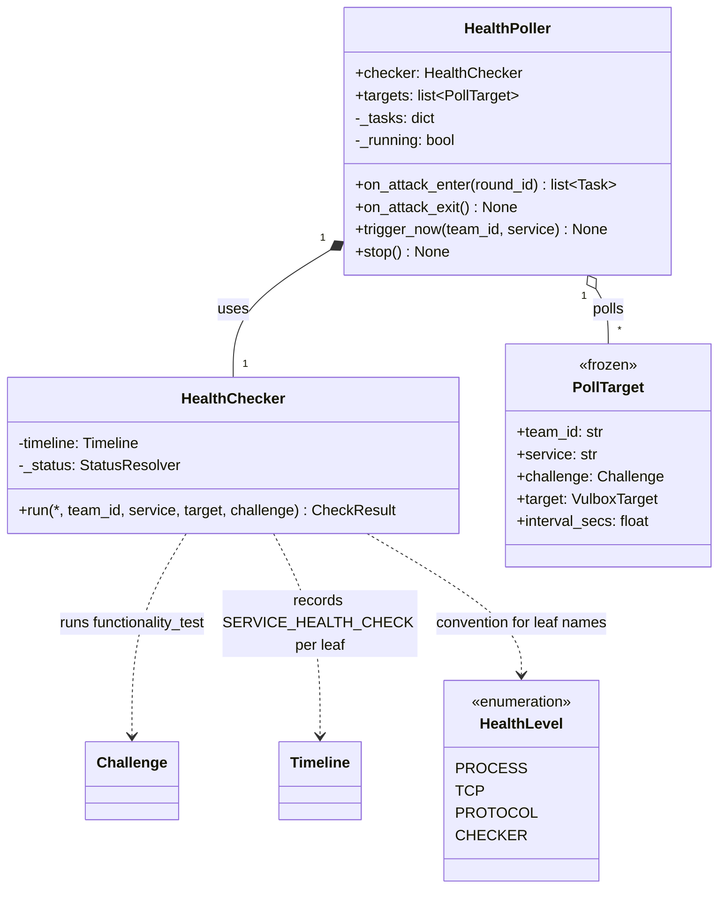

# Health facility — UML

`health/` is an independent package consumed by `GameMgr`. Two classes:

- **`HealthChecker`** — thin wrapper that runs
  `challenge.functionality_test.run(target)` in a thread executor,
  walks the returned `CheckResult` tree, and emits one
  `SERVICE_HEALTH_CHECK` per leaf on the Timeline. Stateless; the
  status resolver (round + phase stamping) is the only injected dep.

- **`HealthPoller`** — periodic scheduler. Driven by GameMgr at phase
  boundaries; does not subscribe to anything. Owns per-target periodic
  tasks (one per (team, defense-capable service)). Also exposes
  `trigger_now(team, service)` for the restart-post one-shot probe.

The package is pluggable per the v2 `Challenge` ABC: each PollTarget
holds a concrete `Challenge` + a pre-built `VulboxTarget`, and the
checker only knows to call `challenge.functionality_test.run(target)`.

## Class diagram

## State machine — when the poller is running

```mermaid
stateDiagram-v2
  [*] --> Idle
  Idle --> Polling : enter_attack_phase\non_attack_enter(round_id)
  Polling --> Polling : every interval_secs\n→ checker.run
  Polling --> Idle : enter_defense_phase\non_attack_exit()
  Polling --> Idle : on_game_end / stop()
  note right of Polling
    immediate probe per target on entry
    then per-target periodic task:
    while True: sleep(interval); run()
  end note
```

`trigger_now` is allowed in **either** state — used by `_run_restart_job`
in `GameMgr` to surface a fresh check right after a successful restart,
even during DEFENSE.

## Configuration

- **Which services get polled:** `build_targets` filters on
  `challenge.restart_handler is None`. Attack-only challenges (notes)
  have nothing to defend, so periodic CHECKER probes there would be
  wasted load.
- **Per-challenge poll interval:** lives in
  [`challenges/registry.py::_HEALTH_INTERVAL_SECS`](../../challenges/registry.py).
  `build_targets` reads it via the `interval_lookup` injected callable
  (typically `registry.health_interval_secs`) with `DEFAULT_INTERVAL_SECS`
  (10s) as the fallback.
- **Leaf names:** the `HealthLevel` enum (PROCESS / TCP / PROTOCOL /
  CHECKER) is a convention. The framework emits one event per
  `CheckResult` leaf using `leaf.name` verbatim; both bundled
  challenges use this convention. A challenge whose `FunctionalityTest`
  returns a different tree shape (one leaf, nested groups) is free to;
  no framework code branches on the names.

## What it does NOT do

- **Does not subscribe to anything.** GameMgr drives all entry/exit;
  the poller has no Timeline / pub-sub coupling beyond `record()`.
- **Does not run during DEFENSE.** `on_attack_exit` cancels all tasks
  on every DEFENSE entry; `trigger_now` is the only DEFENSE-time path.
- **Does not deduplicate** a `trigger_now` racing the periodic loop.
  Both records are independent events; the panel reads them as-is.

## File map

| Path | Role |
|---|---|
| `health/__init__.py` | re-exports `HealthChecker`, `HealthPoller`, `PollTarget` |
| `health/checker.py` | `HealthChecker.run` + `leaves(tree)` tree-walker |
| `health/poller.py` | `HealthPoller` + `PollTarget` + `build_targets` + `DEFAULT_INTERVAL_SECS` |
