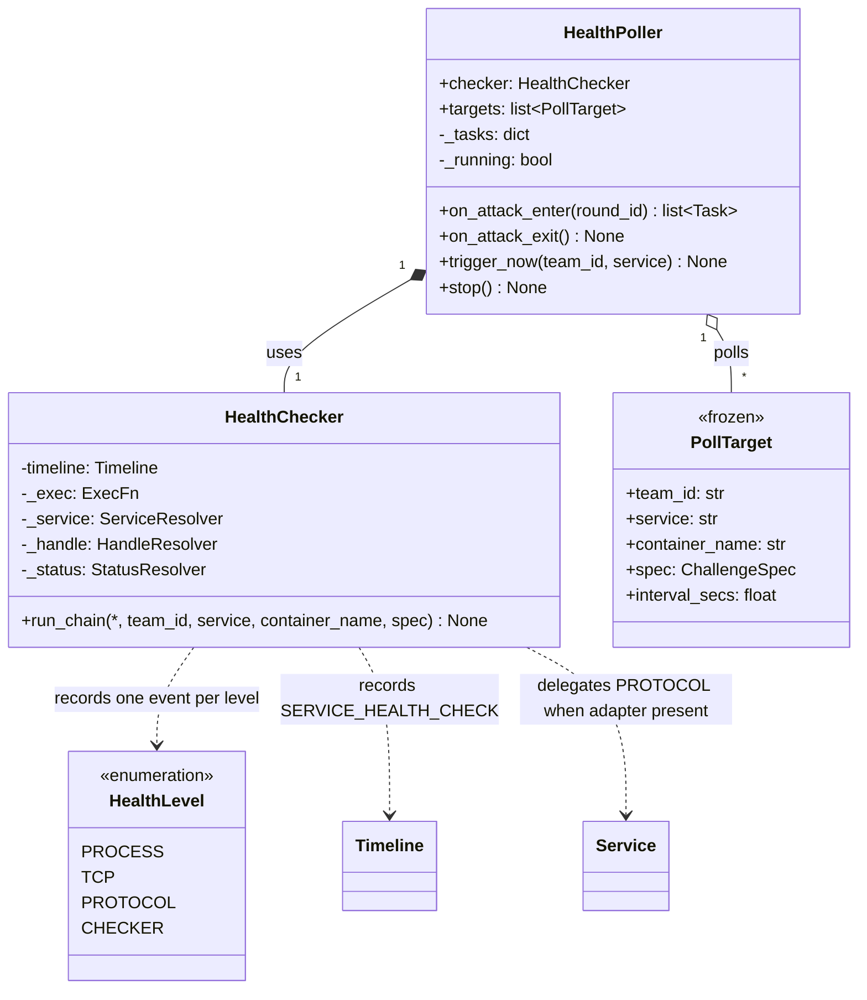

# Health facility — UML

`health/` is an independent package consumed by `GameMgr`. Two classes:

- **`HealthChecker`** — pure 4-level probe primitive
  (PROCESS → TCP → PROTOCOL → CHECKER). Records one
  `SERVICE_HEALTH_CHECK` per level on the Timeline. Stateless;
  dependencies (docker exec, Service resolver, container handle
  resolver, round/phase stamping) are injected at construction so the
  class is unit-testable without a live game.

- **`HealthPoller`** — periodic scheduler. Driven by GameMgr at phase
  boundaries; does not subscribe to anything. Owns per-target periodic
  tasks (one per (team, defense-capable service)). Also exposes
  `trigger_now(team, service)` for the restart-post one-shot probe.

The package is pluggable per the `Service` ABC: protocol-level checks
delegate to `Service.is_alive(handle, level)` when an adapter is
registered. No demo-service specifics are hardcoded.

## Class diagram

## State machine — when the poller is running

```mermaid
stateDiagram-v2
  [*] --> Idle
  Idle --> Polling : enter_attack_phase\non_attack_enter(round_id)
  Polling --> Polling : every interval_secs\n→ checker.run_chain
  Polling --> Idle : enter_defense_phase\non_attack_exit()
  Polling --> Idle : on_game_end / stop()
  note right of Polling
    immediate probe per target on entry
    then per-target periodic task:
    while True: sleep(interval); run_chain()
  end note
```

`trigger_now` is allowed in **either** state — used by `_run_restart_job`
in `GameMgr` to surface a fresh chain right after a successful restart,
even during DEFENSE.

## Configuration

Per-spec under `metadata.health_check`:

| Key | Used by | Default |
|---|---|---|
| `process_pattern` | PROCESS level | none → record "skipped" |
| `checker_command` | CHECKER level | none → alias PROTOCOL outcome |
| `interval_secs` | HealthPoller periodic loop | `DEFAULT_INTERVAL_SECS` (10s) + warning |

`port` lives on the spec root (TCP probe uses it). Defense-capability
is determined by `metadata.restart_cmd` — `build_targets` filters out
services that lack one (e.g. notes is not polled).

## What it does NOT do

- **Does not subscribe to anything.** GameMgr drives all entry/exit;
  the poller has no Timeline / pub-sub coupling beyond `record()`.
- **Does not run during DEFENSE.** `on_attack_exit` cancels all tasks
  on every DEFENSE entry; `trigger_now` is the only DEFENSE-time path.
- **Does not deduplicate** a `trigger_now` racing the periodic loop.
  Both records are independent events; the panel reads them as-is.

## File map

| Path | Role |
|---|---|
| `health/__init__.py` | re-exports `HealthChecker`, `HealthPoller`, `PollTarget` |
| `health/checker.py` | `HealthChecker.run_chain` (PROCESS → TCP → PROTOCOL → CHECKER) |
| `health/poller.py` | `HealthPoller` + `PollTarget` + `build_targets` + `DEFAULT_INTERVAL_SECS` |
