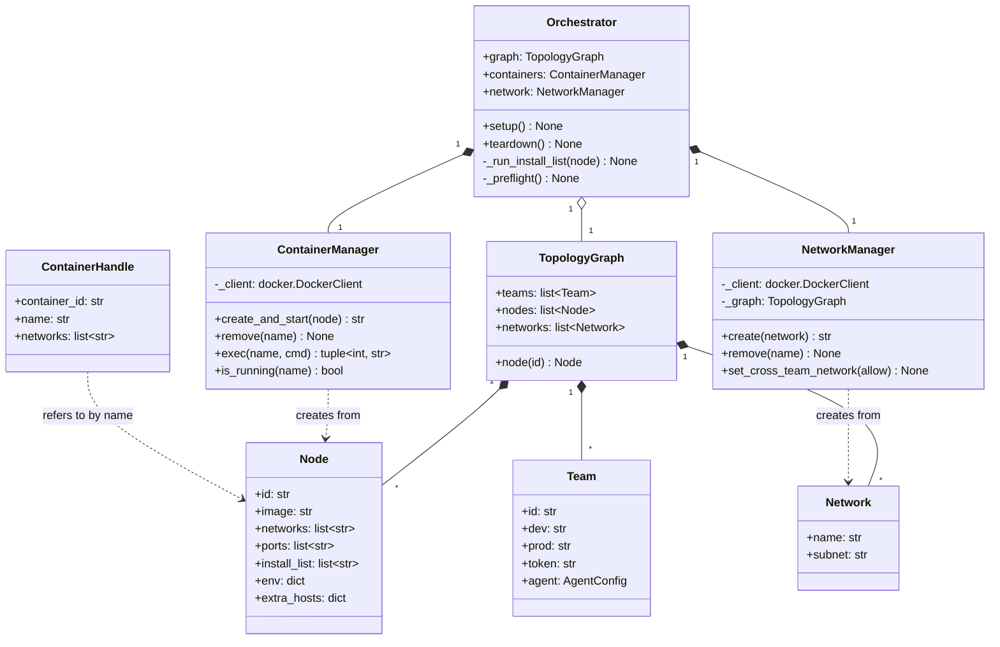
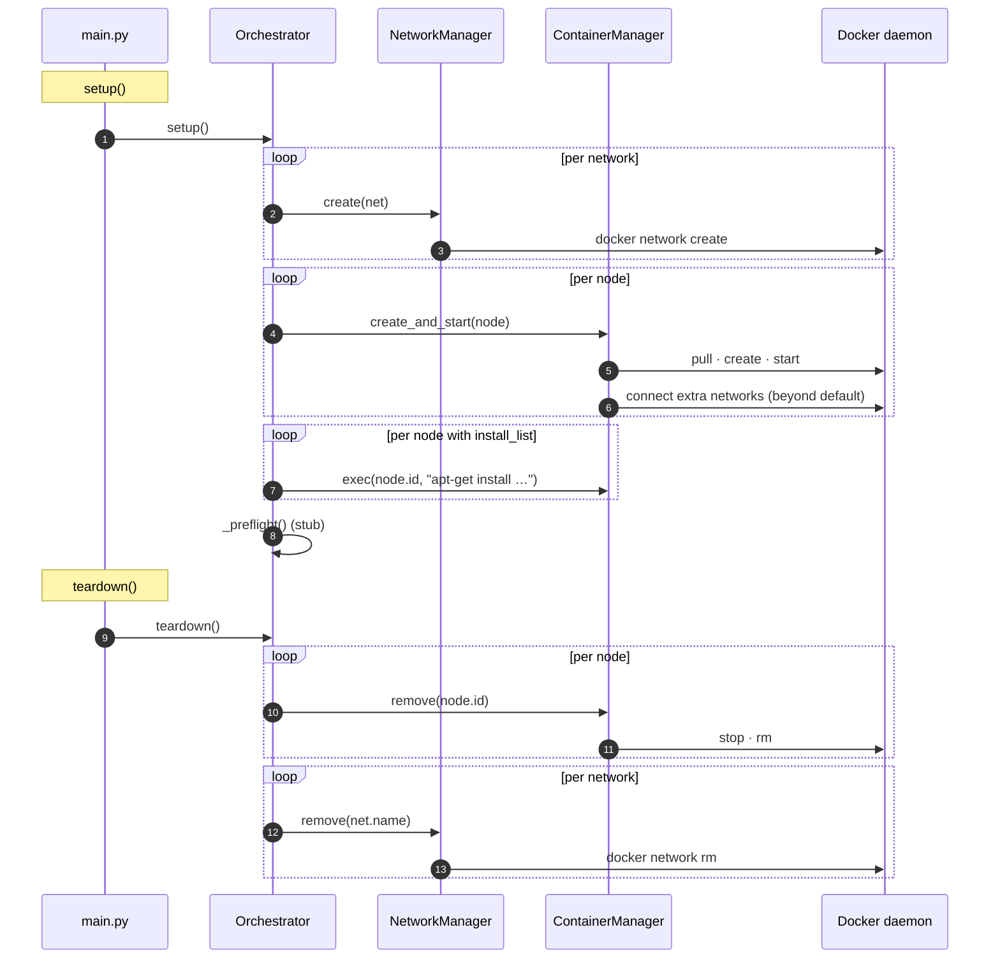
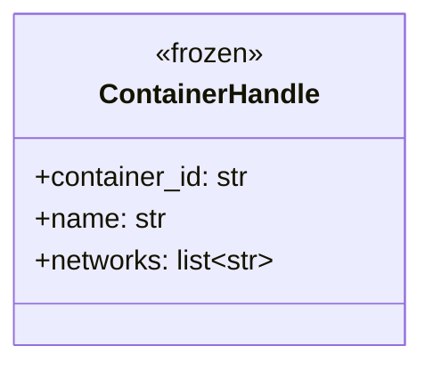

# Orchestrator layer — UML

Container + network lifecycle for the arena. Owns Docker. Knows
nothing about agents or game state — those build on top.

## Class diagram

## Network state per phase

The arena has three classes of network:

| Network | Always connected | Phase gate |
|---|---|---|
| `team{N}_net` | yes (intra-team) | always — `team{N}_dev` ↔ `team{N}_prod` |
| `game_net` | only in ATTACK | `set_cross_team_network(allow=True)` attaches all prods |
| `attack_net_team{N}` | only in ATTACK | per-team attacker net (opponent's dev ↔ this team's prod) |

`set_cross_team_network(allow)` flips both `game_net` and the
`attack_net_*` family in lockstep — DEFENSE = all detached, ATTACK
= all attached. Detach is implemented by `docker network disconnect`
and re-attach by `docker network connect`.

## Setup / teardown sequence

## ContainerHandle — opaque pointer to a running container

The agents layer, transport backends, and the flag/health facilities
pass `ContainerHandle` to identify which container a command targets.
Decoupled from the legacy `Service` ABC (deleted with the challenge
interface v2 migration); per-challenge install/start/restart lifecycle
now lives in the `Challenge` ABC's `flag_handler` / `restart_handler`
and the `challenges.registry.initial_start` hook. See
[challenges.md](challenges.md).

## File map

| Path | Role |
|---|---|
| `orchestrator/orchestrator.py` | `Orchestrator` (setup / teardown) |
| `orchestrator/infra/docker.py` | `ContainerManager` |
| `orchestrator/infra/network.py` | `NetworkManager` |
| `orchestrator/handle.py` | `ContainerHandle` dataclass |
| `orchestrator/topology.py` | YAML → `TopologyGraph` |
| `models/topology.py` | `Team` / `Node` / `Network` / `TopologyGraph` dataclasses |
