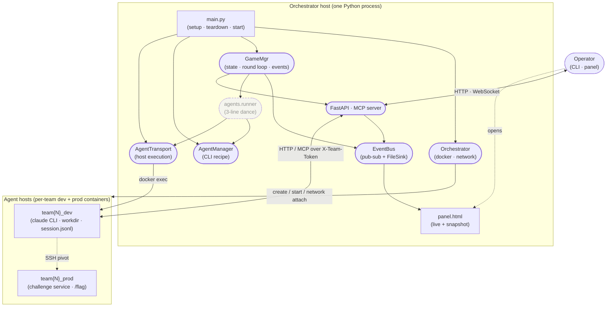

# CyberArena — System Overview

How the pieces fit together at the highest level. Drill down into a
section for class diagrams + sequence diagrams.

## Component diagram



## Roles

| Component | Responsibility | Details |
|---|---|---|
| **main.py** | Entry point | Wires `Orchestrator`, `GameMgr`, `AgentManager` per team via registry, registers handlers, starts FastAPI + round loop |
| **Orchestrator** | Docker lifecycle | Creates containers + networks per [topology.yaml](../m1_topology_plan.md), exposes `set_cross_team_network(allow)` for phase-driven isolation. See [orchestrator.md](orchestrator.md) |
| **GameMgr** | Game state | Owns event bus, round loop, flag store, artifact store. Emits AGENT_* / FLAG_* / SERVICE_* events. See [game_manager.md](game_manager.md) |
| **AgentManager** | Per-CLI recipe | ABC: `install` + `phase_command` + 2 constants. Concrete: ClaudeAgentManager (codex / gemini future). See [agent_manager.md](agent_manager.md) |
| **AgentTransport** | Host execution | Protocol: `run_command` / `write_file` / `kill_process`. Concrete: DockerExecBackend (SSH later). See [agent_manager.md](agent_manager.md) |
| **agents.runner** | Glue | One free function: stage prompt → run CLI with timeout → pkill on timeout. Returns raw `CommandResult` to caller. See [agent_manager.md](agent_manager.md) |
| **FastAPI + MCP** | External surface | REST `/game/flag/submit` etc.; WebSocket `/events/stream` for panel; MCP HTTP `/mcp/` for agent tool calls |
| **panel.html** | Observer UI | Live mode connects WebSocket; snapshot mode replays `events.jsonl` embedded at game end (`runs/<ts>/panel.html`) |
| **Challenge** | Pluggable service | `ChallengeSpec` + `Service` adapter; sources are notes (built-in) and nautilus. See [challenges.md](challenges.md) |

## Game lifecycle (one game, top-down)

```
main.py
  ├─ Orchestrator.setup()          ← create containers + networks
  ├─ GameMgr.deploy_challenges()    ← install challenge into prod containers
  ├─ GameMgr.plant_initial_flags()  ← R0 flag plant
  └─ GameMgr.start()
       ├─ install_all_agents()      ← npm install + ssh pivot + agent.env / mcp.json per team
       ├─ dry_run_all_agents()      ← per-team readiness probe (report_ready via MCP)
       └─ RoundLoop.run()
            ├─ R1: DEFENSE → ATTACK
            ├─ R2: DEFENSE → ATTACK
            └─ R3: DEFENSE → ATTACK → GAME_END

         (game.stop closes file sink; panel_snapshot.write_snapshot
          freezes the run into runs/<ts>/panel.html)
```

Two cross-cutting concerns:

- **Memory across phases** — Claude CLI's `--continue` flag re-loads
  the session store at `~/.claude/projects/<workdir-cwd>/<id>.jsonl`,
  pinned to a dedicated workdir per arena.
- **MCP control channel** — agent calls `submit_flag` /
  `report_ready` / `restart_service` / `report_deploy_complete` on
  the orchestrator's FastMCP HTTP endpoint; each tool authenticates
  via `X-Team-Token`.

## Further reading

- [docs/UML/agent_manager.md](agent_manager.md) — agent layer (install + phase_command + transport + runner)
- [docs/UML/game_manager.md](game_manager.md) — GameMgr internals (event bus, round loop, artifacts, flags)
- [docs/UML/orchestrator.md](orchestrator.md) — Docker / network lifecycle
- [docs/UML/challenges.md](challenges.md) — pluggable challenge sources
- [docs/persistent_memory_agent_plan_v1.md](../persistent_memory_agent_plan_v1.md) — design rationale for the agent layer
- [docs/design_v1.7.md](../design_v1.7.md) — overall system design
