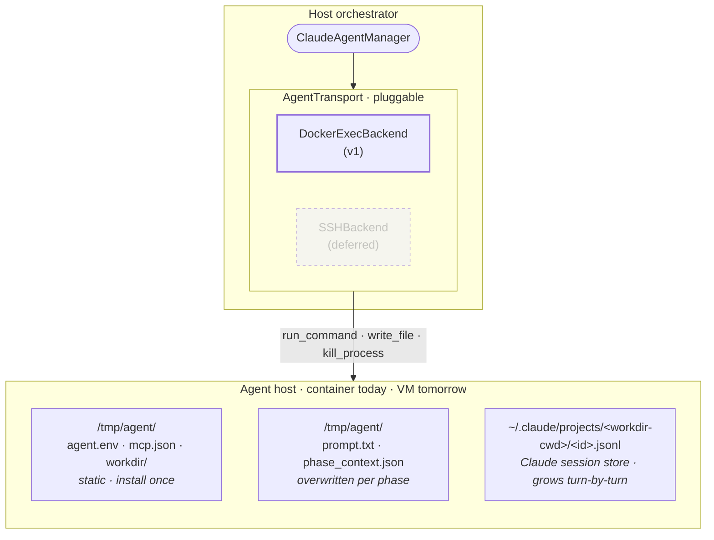
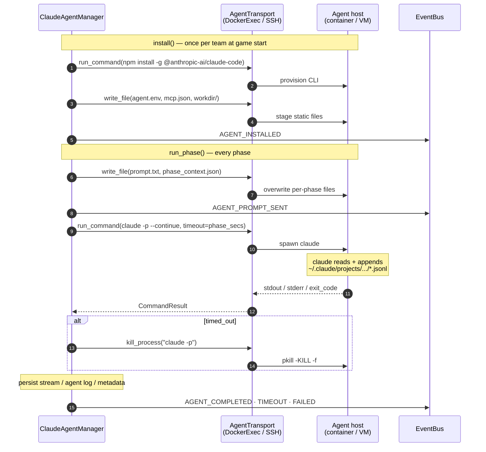

# Persistent-Memory Agent — Plan v1

## What we're building

**Install once per team. Per phase, the orchestrator runs
`claude -p --continue` on the agent host through a pluggable
`AgentTransport`. Memory carries across phases via Claude CLI's
session store on disk.**

No in-container daemon. No file IPC for control signals. The
orchestrator is the controller; Claude is a short-lived process
spawned once per phase.

> **The persistent component is Claude CLI's session store on disk,
> not any process.** Claude exits between phases. `--continue`
> reloads the session under
> `/root/.claude/projects/<workdir-cwd>/<id>.jsonl` on the next
> invocation.

> **Assumption — Claude CLI session selection is cwd-scoped.** We
> pin every invocation to `/tmp/agent/workdir/` so `--continue` only
> sees this arena's sessions. If a future Claude release changes the
> cwd → session mapping, switch to explicit `--resume <id>`.

---

## Architecture

**Per round, sync mode** — each phase is one `run_phase` invocation:

| Phase | Action |
|---|---|
| R1 DEFENSE | stage prompt → `claude -p --continue` → artifacts |
| R1 ATTACK | same |
| R2 DEFENSE | same |
| … | … |

Each invocation is a fresh process; `--continue` makes it one logical
conversation.

### Why no in-container daemon

An earlier draft put a Python daemon (`ClaudeAgentRunner`) inside the
container, fed by file IPC (`cue`, `kill`, `shutdown`, `done.json`).
Redundant in both modes:

| Daemon's job | Where it actually lives |
|---|---|
| Stable PID across phases | Container/host IS the stable identity |
| Cue / done file IPC | `transport.run_command` returns directly |
| SIGTERM → SIGKILL on timeout | Inside the transport's `run_command` |
| Atomic `done.json` | Result is in memory on the host |
| Transcript append | Host writes artifacts directly |
| `--continue` memory | Works regardless of invoker |

In **sync mode** the orchestrator controls phases. In **async mode**
the agent self-controls via MCP. A daemon between them has nothing to
decide. Drop permanently.

---

## Two abstractions: AgentManager × AgentTransport

The agent layer has two orthogonal interfaces. Keeping them separate
means we can swap CLIs (Claude → codex/other) without touching the
host transport, and swap host transports (docker → SSH) without
touching CLI-specific install + invocation logic.

### `AgentManager` (ABC)

CLI-flavor-specific. One concrete manager per agent CLI. The contract:

| Method | Phase | Purpose |
|---|---|---|
| `install(container, cfg)` | game start, once per team | npm install / SSH pivot / env / mcp.json / workdir. No process launched. |
| `run_phase(container, prompt, *, round_id, phase, timeout, artifact_dir, model) → DoneInfo` | every phase | deliver `prompt`, invoke the CLI on the host through the transport, capture artifacts, return DoneInfo |
| `status(container)` / `kill(container)` / `fetch_logs(container)` | observability | M4-era hooks; best-effort no-ops under v1 |

`ClaudeAgentManager` (the v1 concrete class) implements both methods
on top of `AgentTransport` — it never calls `docker exec` itself.

### `AgentTransport` (Protocol)

Host-flavor-specific. One concrete backend per host kind:

| Backend | Status | Handle |
|---|---|---|
| `DockerExecBackend` | v1 | container name |
| `SSHBackend` | deferred | host / user / key |

Surface: `connect`, `run_command` (async; SIGTERM → SIGKILL on timeout),
`write_file`, `read_file`, `kill_process`. `AgentHandle` is opaque to
the manager; the transport interprets it.

The split means adding a new CLI (e.g. codex) is one new `AgentManager`
subclass; adding a new host (e.g. remote VM) is one new
`AgentTransport`. Neither change touches the other axis.

---

## Lifecycle

### 1. Game start — `install()` once per team

1. `transport.run_command(["npm", "install", "-g", "@anthropic-ai/claude-code"])`
2. `_provision_ssh_pivot` (existing M5.6 SSH key push, now via transport)
3. `transport.write_file` → `/tmp/agent/mcp.json` and `agent.env`
4. `transport.run_command(["mkdir", "-p", "/tmp/agent/workdir"])`
5. Emit `AGENT_INSTALLED`

No process launches here. The next phase's `run_phase` is what first
starts Claude.

### 2. Each phase — `run_phase(...) → DoneInfo`

The kickoff subscriber awaits one `run_phase` per (team, phase):

1. Stage `prompt.txt` + `phase_context.json` via the transport.
2. Emit `AGENT_PROMPT_SENT`.
3. Run `claude -p --continue` on the agent host through the transport,
   bounded by the phase timer.
4. On timeout: belt-and-suspenders `pkill` inside the agent host
   (defends against `docker exec` swallowing the SIGTERM).
5. Persist `stream-{phase}.jsonl` / `agent-{phase}.log` /
   `metadata-{phase}.json` to the host artifact dir.
6. Emit `AGENT_COMPLETED` / `AGENT_TIMEOUT` / `AGENT_FAILED`.

### 3. Game end

Nothing to tear down inside the agent host. `Orchestrator.teardown()`
reaps the dev containers as today; the session store dies with them.

---

## `DoneInfo` — `run_phase` return shape

| Field | Meaning |
|---|---|
| `exit_code` | CLI process exit (signal-exits non-zero on timeout) |
| `timed_out` | `true` iff the transport had to escalate SIGTERM → SIGKILL |
| `started_at`, `ended_at`, `duration_ms` | wall-clock bookends |
| `stdout_path`, `stderr_path` | paths to the persisted stream / log files (empty when `artifact_dir=None`) |

This is the same shape as the per-phase `metadata-{phase}.json`
artifact, so callers can serialize it directly.

Implementations must:
- Honor `timeout` and escalate SIGTERM → SIGKILL on expiry; set
  `timed_out=True` in DoneInfo.
- When `artifact_dir` is provided, write the three sibling files
  (`stream-{phase}.jsonl`, `agent-{phase}.log`, `metadata-{phase}.json`)
  into it. When `None`, return DoneInfo with empty path fields and let
  the caller persist.
- Never raise on agent-side failures — surface them via `exit_code` /
  `stderr` so the round loop keeps ticking.

Subprocess management, signal escalation, and transport-specific
quirks live entirely behind `AgentTransport`. Unit-test `run_phase`
against an in-memory `FakeTransport`.

---

## File layout

In the agent host (written by transport; read by Claude or for
provenance):

| Path | Lifecycle |
|---|---|
| `/tmp/agent/agent.env`, `mcp.json` | static; install once |
| `/tmp/agent/workdir/` | static dir; claude's cwd for `--continue` isolation |
| `/tmp/agent/prompt.txt` | overwritten per phase; Claude reads via stdin redirect |
| `/tmp/agent/phase_context.json` | overwritten per phase; provenance only |
| `/root/.claude/projects/<workdir-cwd>/<id>.jsonl` | Claude CLI session store; grows turn-by-turn |

On the orchestrator host, per phase (written by `run_phase`):

| Artifact path | What |
|---|---|
| `runs/<ts>/artifacts/team{N}/round-{N}/stream-{phase}.jsonl` | Claude stdout (stream-json transcript) |
| `runs/<ts>/artifacts/team{N}/round-{N}/agent-{phase}.log` | Claude stderr |
| `runs/<ts>/artifacts/team{N}/round-{N}/metadata-{phase}.json` | `{round_id, phase, exit_code, timed_out, duration_ms, prompt_first_line, started_at, ended_at}` |

No `cue` / `done.json` / `runner.pid` / `kill` / `shutdown` — none
exist in this design.

---

## Manager ↔ host interaction

No async handoff; each `run_phase` is a blocking `await` on the
orchestrator. The agent's MCP tool calls flow back over the existing
FastMCP transport — they're independent of the subprocess.

---

## Events

Reuse: `AGENT_INSTALLED` (once per team), `AGENT_READY` (MCP).

New (per phase):
- `AGENT_PROMPT_SENT` — before subprocess starts. Payload: `{phase, round_id, prompt_first_line}`.
- `AGENT_COMPLETED` — clean exit (exit_code 0). Payload: `{exit_code, duration_ms, phase, round_id}`.
- `AGENT_TIMEOUT` — phase timer expired; subprocess killed. Same shape.
- `AGENT_FAILED` — non-zero exit, not from timeout. Same shape + `error_excerpt`.

Drop or keep-for-back-compat: `AGENT_LAUNCHED` (no persistent launch
anymore; decide during implementation).

---

## Code changes

| File | Change |
|---|---|
| `agents/manager.py` | `AgentManager` ABC gains abstract `run_phase(...) → DoneInfo` alongside `install`. Status/kill/fetch_logs remain for M4-era observability. |
| `agents/transport.py` (new) | `AgentTransport` Protocol + `CommandResult` + `AgentHandle`. Pure interface. |
| `agents/transport_docker.py` (new) | `DockerExecBackend` — `asyncio.create_subprocess_exec("docker", "exec", ...)` under the hood. |
| `agents/transport_ssh.py` (deferred) | `SSHBackend` sibling for remote VMs. Out of scope for v1. |
| `agents/claude.py` | `ClaudeAgentManager(transport=...)`. `install()` becomes one-shot setup via transport primitives. New async `run_phase(...) → DoneInfo` (the ABC implementation). `_launch` retires. |
| `models/agent.py` | New `DoneInfo` frozen dataclass. |
| `gamemgr/game_mgr.py` | Pre-loop install hook (parallel via `asyncio.gather`). Kickoff handlers call `run_phase` instead of `install`. `_agent_briefed: set[str]` so the long briefing only goes out once. |
| `gamemgr/events.py` | Add `AGENT_PROMPT_SENT`, `AGENT_COMPLETED`, `AGENT_TIMEOUT`, `AGENT_FAILED`. |
| `agents/prompts/*` | First phase = full briefing + first task. Subsequent = 2–3 lines. |
| `panel/panel.html` | Render new event chips. |
| `main.py` | Construct `DockerExecBackend()` + inject. `_wire_defense_kickoff` → `_wire_phase_kickoffs`. |
| `tests/test_dcf_transport_docker.py` (new) | Mock `asyncio.create_subprocess_exec`; verify timeout escalation, write/read/kill paths. |
| `tests/test_dcf_run_phase.py` (new) | Manager logic against an in-memory `FakeTransport`; one docker-gated live test runs 2 phases and verifies `--continue` memory carries. |

**Existing tests** (M4 / M4.5 / M5.6) each call `install()` once in
isolation. `install()`'s public shape is preserved; only internals
change. No behavioral changes expected; re-run the suite to confirm.

**Estimate**: ~120 LOC + 4 tests.

---

## Risks

| Risk | Mitigation |
|---|---|
| Signals don't propagate through `docker exec` | `transport.kill_process` (pkill) after `run_command` times out |
| `--continue` resumes a wrong session | Dedicated `workdir/` cwd isolates this arena's sessions |
| Container exits mid-phase | `run_command` fails immediately → `AGENT_FAILED` |
| MCP transport hiccups while `run_phase` is awaiting | `run_phase` is async; FastAPI / FastMCP keep responding |
| Conversation tokens grow unbounded | Deferred: `--fork-session` at round boundary or compress-history MCP tool |
| Stale session store from a prior run | Container is recreated by `Orchestrator.setup` each game |

---

## Async mode (parking lot)

For autonomous agents (decide what to do, defend + attack in parallel,
query round state via MCP):
- Add MCP tools: `get_round_state`, `list_opposing_prods`, `list_active_flags`.
- Replace per-phase `run_phase` with one long-running `run_command` at
  game start carrying a "you drive yourself" prompt.
- Agent loops internally via MCP; orchestrator owns timers + flag
  rotation + network switching.

v1 constraints to keep async reachable:
- ❌ Don't bake phase-time-budgets into per-challenge prompts.
- ✅ Keep MCP tools additive; never reshape existing tools.

---

## Decisions (resolved)

| # | Decision | Choice |
|---|---|---|
| D1 | In-container daemon or host-driven? | **Host-driven, permanently.** Daemon is redundant in sync (orchestrator controls) AND async (agent self-controls via MCP). |
| D2 | Coexist with old `install + _launch`, or replace? | **Fully replace.** `install()` keeps its public shape; internals stop launching a supervisor. M4 / M4.5 / M5.6 tests stay valid. |
| D3 | Per-phase artifacts? | **stdout + stderr + metadata.json** under `runs/<ts>/artifacts/team{N}/round-{N}/`. |
| D4 | One session per team, or separate defense/attack sessions? | **One session.** Operator-role model; defense knowledge informs attack. |
| D5 | First-phase prompt = briefing + first task, or briefing-only at install + tasks later? | **Combined first prompt.** Subsequent prompts are 2–3 line task cues. |
| D6 | Manager talks to host directly, or through a transport interface? | **Transport interface.** `AgentTransport` Protocol; `DockerExecBackend` v1; `SSHBackend` deferred. Manager unchanged when backend swaps. |
